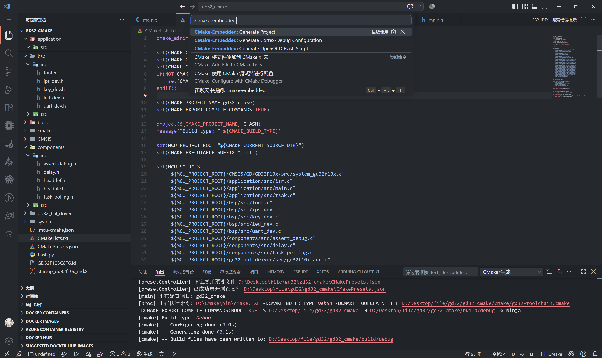

[English documentation](README.zh-CN.md)

# CMake-Embedded

一款用于 VS Code 的 CMake 工程生成插件，支持三个**互相独立**的方向：

- **MCU 固件**：裸机 STM32 / GD32 工程，生成链接脚本、GNU 启动文件、工具链和 CMake。
- **Linux / SoC 应用**：交叉编译工程，目标为龙芯 (loongarch64)、ARM (aarch64)、
  32 位 ARM (armv7 hard-float) 或 RISC-V (riscv64)。
- **桌面 C/C++**：使用本机编译器生成普通可执行文件、静态库或动态库。

三个方向都会扫描当前打开的工程目录，收集 C/C++ 源文件、头文件目录和宏，
然后生成可直接构建的 CMake 工程。

## 侧栏快速生成

安装插件后，VS Code 左侧活动栏会显示 **CMake-Embedded** 图标。打开工程目录，
点击该图标即可在侧栏中切换 **MCU 固件**、**Linux / SoC** 和
**桌面 C/C++**，选择目标后点击“生成工程”。

- 选择结果按工作区保存，下次打开自动恢复。
- MCU 页面可同时生成 `flash.py` 和 Cortex-Debug 配置。
- 桌面 C/C++ 页面可选择可执行文件、静态库或动态库以及语言标准。
- 扫描工作区后可查看源文件、头文件目录和宏的数量。
- 原有命令面板入口全部保留，可继续单独生成烧录脚本或调试配置。

## 命令

| 命令 | 方向 | 说明 |
| --- | --- | --- |
| `CMake-Embedded: Generate MCU Project` | MCU | 按命令面板流程选择厂商、系列和型号，再生成裸机工程 |
| `CMake-Embedded: Generate Linux Project` | Linux | 选择交叉工具链，再生成交叉编译工程 |
| `CMake-Embedded: Generate C/C++ Project` | 桌面 | 选择目标类型和语言标准，生成普通 CMake 工程 |
| `CMake-Embedded: Generate OpenOCD Flash Script` | MCU | 仅生成 `flash.py` |
| `CMake-Embedded: Generate Cortex-Debug Configuration` | MCU | 仅生成 `.vscode/launch.json` 调试配置 |

---

## 桌面 C/C++ 方向

### 功能

- 使用本机 GCC、Clang 或 MSVC 工具链，不生成交叉工具链文件。
- 自动扫描 C/C++/汇编源文件、头文件目录和宏。
- 支持可执行文件、静态库和动态库。
- 支持 C11/C17/C23 与 C++14/C++17/C++20/C++23。
- 生成 Debug、Release 的 Ninja 预设和编译数据库。
- 配置 CMake Tools 与 C/C++ IntelliSense。
- 保留 `CMAKE-EMBEDDED USER CODE` 区域，可自行添加依赖库。

### 使用

1. 打开普通 C/C++ 工程目录。
2. 在侧栏切换到 **桌面 C/C++**。
3. 选择目标类型和语言标准，点击“生成工程”。
4. 使用生成的预设配置并构建：

   ```powershell
   cmake --preset debug
   cmake --build --preset debug
   ```

### 生成后的目录结构

```text
<project>/
├── CMakeLists.txt
├── CMakePresets.json
├── .native-cmake.json
└── .vscode/
    ├── settings.json
    └── c_cpp_properties.json
```

---

## MCU 方向

### 功能

- 根据当前工程目录生成 `CMakeLists.txt`
- 生成 MCU 链接脚本和 GNU 汇编启动文件
- 在 `system/` 目录生成 C 运行时支持文件
- 生成适用于 Ninja 的 Debug 和 Release 配置及构建预设
- 配置 CMake Tools 使用生成的工程预设
- 使用 CMake 编译数据库配置 C/C++ 插件 IntelliSense
- 可选生成独立于 CMake 的 OpenOCD `flash.py` 烧录脚本
- 生成 Cortex-Debug 的 OpenOCD 调试配置
- 构建成功后生成 `.elf`、`.hex` 和 `.bin` 文件
- 覆盖已有生成文件前进行确认

烧录脚本支持 J-Link OB、J-Link、ST-Link 和 DapLink。CMake 构建芯片和
OpenOCD 烧录 target 独立选择，因此也可以给已有自定义 CMake 工程单独生成
烧录脚本。GD32 F1/F4 target 使用兼容的 STM32 F1/F4 OpenOCD target。

### 演示



当前芯片数据库支持常用的 STM32/GD32 F1、F4 型号和 STM32L4 型号。
侧栏和命令面板都会先按厂商选择，再按系列和具体型号选择。

### 使用方法

1. 使用 VS Code 打开 MCU 工程目录。
2. 点击活动栏中的 **CMake-Embedded**，进入“生成配置”。
3. 选择厂商、系列和型号，按需勾选烧录脚本或调试配置，然后点击“生成工程”。
4. 使用生成的预设配置并构建工程：

   ```powershell
   cmake --preset debug      # 或 cmake --preset release
   cmake --build --preset debug
   ```

启用 `flash.py` 后，侧栏会显示 OpenOCD target、调试器和路径高级选项。
也可以点击“仅生成 flash.py”。烧录 target 覆盖 STM32
F0/F1/F2/F3/F4/F7/G0/G4/H7/L0/L1/L4/L5/U5/WB/WL 和 GD32
E23x/F1/F4/VF103 系列。

如果 OpenOCD 不在系统 `PATH` 中，可在 VS Code 设置里配置
`CMake-Embedded: Openocd Path`（`cmakeEmbedded.openocdPath`）。
生成的脚本会以该路径为默认值，也支持运行时覆盖：

```powershell
python flash.py
python flash.py --firmware build/my-project.elf
python flash.py --probe stlink
python flash.py --openocd D:\Tools\OpenOCD\bin\openocd.exe
python flash.py --dry-run
```

如果 Cortex-Debug 找不到 ARM GNU 工具链，可配置
`CMake-Embedded: Arm Toolchain Path`（`cmakeEmbedded.armToolchainPath`），
填写 `arm-none-eabi` 工具所在的 `bin` 目录。

勾选“生成 Cortex-Debug 配置”或点击同名命令后，插件会向
`.vscode/launch.json` 添加标准 OpenOCD 调试配置。已有其他配置会保留。
生成后按 `F5` 即可启动 Cortex-Debug。

### 生成后的目录结构

```text
<project>/
├── CMakeLists.txt
├── CMakePresets.json
├── .mcu-cmake.json
├── .vscode/
│   ├── settings.json
│   ├── c_cpp_properties.json
│   └── launch.json             （可选 Cortex-Debug 调试配置）
├── <mcu>.ld
├── startup_<device>.S
├── flash.py                    （可选 OpenOCD 烧录脚本）
├── cmake/
│   └── <device>-toolchain.cmake
└── system/
    ├── syscalls.c
    └── sysmem.c
```

构建目录为 `build/debug` 和 `build/release`。固件输出、map 文件和内存使用
报告也会生成在该目录下。

---

## Linux 方向

### 功能

- 根据当前工程目录生成 `CMakeLists.txt`
- 生成交叉编译工具链文件 `cmake/linux-toolchain.cmake`
- 生成 Debug 和 Release 两个 Ninja 配置及构建预设
- 生成 `.linux-cmake.json`，记录所选工具链和工程结构
- 配置 CMake Tools 和 C/C++ IntelliSense
- 覆盖已有生成文件前进行确认

工具链文件只写**编译器命令名**（例如 `loongarch64-linux-gnu-gcc`），
不写绝对路径，因此同一工程可以在不同机器上使用。

### 支持的交叉工具链

| 名称 | 前缀 | `CMAKE_SYSTEM_PROCESSOR` |
| --- | --- | --- |
| 龙芯 (loongarch64) | `loongarch64-linux-gnu-` | `loongarch64` |
| ARM (aarch64) | `aarch64-linux-gnu-` | `aarch64` |
| ARM 32 位 (armv7 hard-float) | `arm-linux-gnueabihf-` | `arm` |
| RISC-V (riscv64) | `riscv64-linux-gnu-` | `riscv64` |

### 工具链查找

插件不保存交叉工具链路径，只从环境变量查找：

1. `CROSS_COMPILE`，例如 `export CROSS_COMPILE=loongarch64-linux-gnu-`
2. `CC` / `CXX`
3. `PATH` 中匹配上述前缀的 `gcc` + `g++`

侧栏始终列出四个工具链系列。已找到的工具链会显示来源和目录；未找到的
工具链也可以生成工程，只需在构建前把对应 `bin` 目录加入 `PATH`。

### 使用方法

1. 使用 VS Code 打开**一个工程根目录**。
2. 在 CMake-Embedded 侧栏切换到 **Linux / SoC**。
3. 选择交叉工具链，然后点击“生成工程”。
4. 使用生成的预设配置并构建工程：

   ```bash
   cmake --preset debug      # 或 cmake --preset release
   cmake --build --preset debug
   ```

### 生成后的目录结构

```text
<project>/
├── CMakeLists.txt
├── CMakePresets.json
├── .linux-cmake.json
├── .vscode/
│   ├── settings.json
│   └── c_cpp_properties.json
└── cmake/
    └── linux-toolchain.cmake
```

构建目录为 `build/debug` 和 `build/release`。已有 `CMakeLists.txt` 中
`# CMAKE-EMBEDDED USER CODE BEGIN` 和 `END` 之间的内容会在重新生成时保留。

---

## 环境要求

- VS Code 1.85 或更高版本
- CMake Tools 插件
- C/C++ 插件
- CMake 3.22 或更高版本
- Ninja

- **MCU**：Arm GNU Toolchain，并确保 `arm-none-eabi-gcc`、`arm-none-eabi-g++`、
  `arm-none-eabi-objcopy` 和 `arm-none-eabi-size` 位于 `PATH` 中。
- **Linux**：交叉工具链，并确保对应前缀的 `gcc`、`g++` 位于 `PATH` 中。

## 开发

```powershell
npm install
npm test
```

在 VS Code 中按 `F5` 启动扩展开发主机，打开工程后点击活动栏图标，
即可打开侧栏。

如果在 WSL 中调试 Linux 方向，先在本插件工程的 WSL 窗口按 `F5`，
这样扩展宿主才能读取 WSL 的 `PATH`。

## 项目状态

当前仓库仍是早期插件原型。芯片配置和代码模板保持较小，后续会逐步增加
更多 MCU 系列支持。
